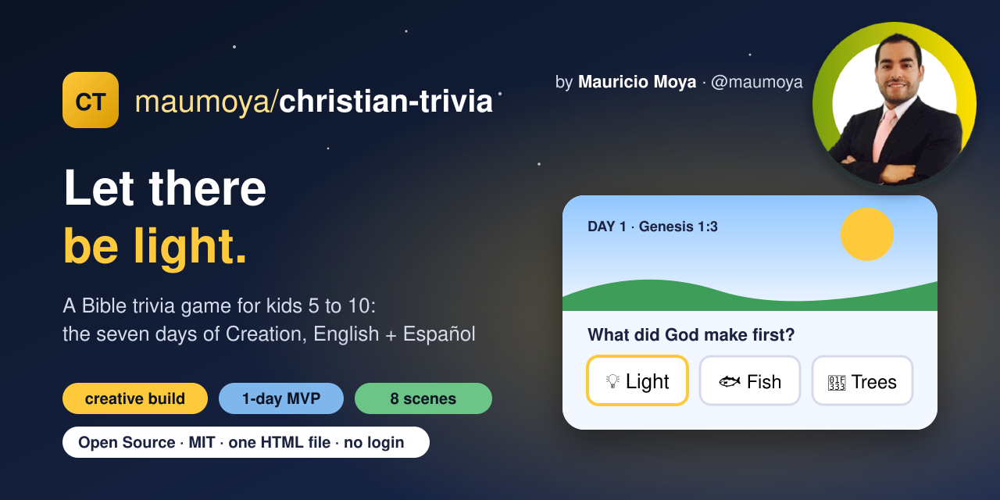

# ✨ Christian Trivia: Creation

  

A short Bible trivia game for kids aged 5 to 10 about Genesis 1 and 2: the seven days of Creation.
Tap the glowing spots, answer one question per scene, and collect a timeline card. On day 6, walk Adam around the garden and name the animals.

**Play:** https://maumoya.github.io/christian-trivia/

## What's inside

- 8 scenes, 9 questions, 12 animals to name, a timeline of 8 cards and a verse to keep.
- English and Español, with read-aloud for kids who don't read yet.
- God is shown as light only. Verses: KJV/WEB (English), RVR1909 (Spanish).
- A parent area behind a simple adult check.
- One HTML file, plain JavaScript and canvas. No engine, no install, no accounts, no tracking.

## A creativity exercise

This is a one-day MVP: build the smallest playable version fast, put it in front of real kids and parents, and learn what the real game needs. A full adventure version, with a player character exploring the world, is the next step.

## Licence

MIT © 2026 Mauricio Alonso Moya Tapia
